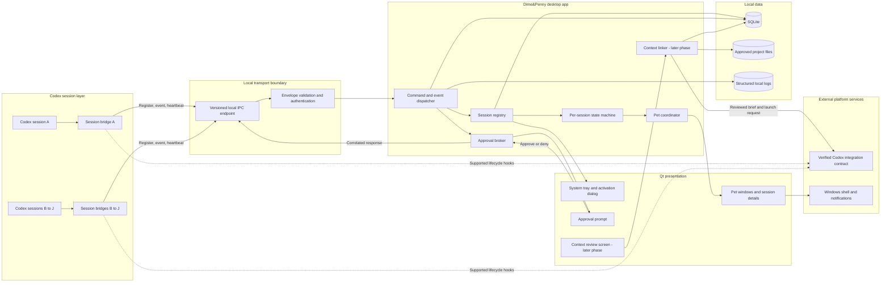
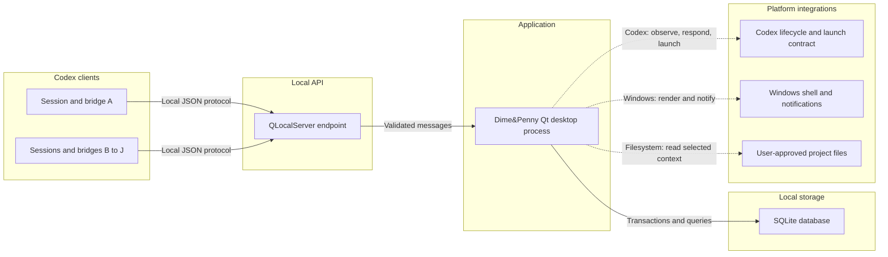

# Dime&Penny Architecture Plan

## 1. Architecture objective

Dime&Penny is a Windows-first desktop companion for up to 10 concurrent Codex sessions. Each registered session owns one visually distinct pet. The pet reflects verified lifecycle events, can surface approval requests, and later helps the user create a new Codex session from an explicitly reviewed combination of project context.

The first release should be a **local modular monolith** written in C++ with Qt. This keeps installation, debugging, state ownership, and security simple while preserving clean module boundaries that can be split later if real scaling or isolation needs appear.

## 2. System design graph

This is the recommended runtime boundary for the MVP. The per-session bridge is deliberately thin: it only observes supported Codex lifecycle signals, adds the Dime&Penny protocol envelope, and communicates with the desktop app over local IPC.



### How to read the graph

- **Codex sessions never update pets directly.** Every incoming message crosses the local IPC and validation boundary.
- **The session registry is the owner of live session identity.** It prevents duplicates, enforces the 10-session limit, and maps exactly one pet identity to each registration.
- **The state machine is the only component allowed to change an agent's lifecycle state.** This prevents malformed, duplicate, late, or out-of-order events from corrupting the UI.
- **The UI renders projections of domain state.** Widgets must not contain registration, transition, persistence, or approval-routing rules.
- **Context linking is a later capability.** It reads only sources the user selects, produces an editable brief with provenance, and creates or continues a Codex session only after confirmation.

## 3. Deployment view



For the MVP, deploy only two program types:

1. One persistent **Dime&Penny desktop process** per signed-in Windows user.
2. One lightweight **session bridge** per registered Codex session.

SQLite remains embedded in the desktop process. No cloud service, network listener, broker, vector database, or separate backend service is required.

## 4. Internal module boundaries

| Module | Owns | Must not own |
|---|---|---|
| `domain` | `Session`, `PetIdentity`, `AgentState`, `AgentEvent`, transition rules, domain errors | Qt widgets, sockets, SQL |
| `application` | Use cases, command/event dispatch, registration, approval correlation, context-link workflow | Raw JSON parsing, widget layout |
| `ipc` | `QLocalServer`, `QLocalSocket`, framing, protocol versions, envelope validation, heartbeats | Session state transitions |
| `persistence` | Repositories, SQLite transactions, migrations, event deduplication constraints | UI state or socket ownership |
| `presentation` | Tray icon, dialogs, pet windows, view models, accessibility | Business rules or SQL |
| `integration` | Codex adapter, Windows shell adapter, project-file reader | Domain policy |
| `observability` | Structured logs, health counters, redaction | Storing unredacted prompts by default |

Recommended source layout:

```text
Dime&Penny/
|-- CMakeLists.txt
|-- app/
|   |-- main.cpp
|   `-- composition_root.cpp
|-- include/dimepenny/
|   |-- domain/
|   |-- application/
|   |-- ipc/
|   |-- persistence/
|   |-- presentation/
|   |-- integration/
|   `-- observability/
|-- src/
|   |-- domain/
|   |-- application/
|   |-- ipc/
|   |-- persistence/
|   |-- presentation/
|   |-- integration/
|   `-- observability/
|-- bridge/
|-- tests/
|   |-- unit/
|   |-- integration/
|   `-- stress/
|-- assets/
|-- docs/
`-- tools/
```

## 5. Source of truth and state ownership

| Concern | Source of truth |
|---|---|
| Current connected sessions | In-memory `SessionRegistry`, rebuilt and reverified after restart |
| Valid lifecycle transitions | Domain state machine |
| Pet identity and appearance | SQLite `pet_identities` record |
| Registration history | SQLite `registrations` record |
| Accepted event IDs | SQLite unique event key plus bounded in-memory cache |
| Approval status | Approval broker plus persisted audit record |
| UI appearance | View model derived from domain state |
| Project context | Original project files; Dime&Penny stores only selected metadata/briefs |

Persisted records must never make a restored session appear connected. After application restart, restored sessions begin as `Disconnected` until the bridge completes a new handshake.

## 6. Local protocol

Every IPC message uses a length-prefixed UTF-8 JSON frame. Newline-delimited JSON should not be used because payload text may contain line breaks.

```json
{
  "protocolVersion": 1,
  "messageId": "uuid",
  "sessionId": "stable-registration-id",
  "timestamp": "RFC-3339 UTC timestamp",
  "type": "event",
  "payload": {}
}
```

Message types for version 1:

| Type | Direction | Purpose |
|---|---|---|
| `register` | Bridge to app | Request a session registration or reconnection |
| `registration_result` | App to bridge | Return accepted/rejected plus current protocol metadata |
| `event` | Bridge to app | Deliver a verified lifecycle event |
| `heartbeat` | Both | Detect stale connections without guessing from the terminal |
| `approval_response` | App to bridge | Return an exact approve/deny decision for one request ID |
| `disconnect` | Both | Close a session intentionally |
| `error` | Both | Report a protocol-level error without changing unrelated sessions |

Protocol rules:

- Reject unsupported versions before processing the payload.
- Require a unique `messageId`; duplicate IDs are idempotent no-ops.
- Bind a socket to one `sessionId` after successful registration.
- Enforce a maximum frame size and a heartbeat timeout.
- Never infer lifecycle state from terminal text.
- Do not place access tokens, full prompts, or file contents in normal logs.

## 7. Core event flow

1. The bridge connects to the named local endpoint and sends `register`.
2. The app validates protocol version, identity, capacity, and project metadata.
3. The registry creates or reactivates the session and assigns its stable pet identity.
4. The app acknowledges registration; only then may the UI show the pet as connected.
5. Each event is framed, validated, deduplicated, ordered, and passed to the state machine.
6. A valid transition updates the session aggregate and its UI projection.
7. The accepted event and resulting state are stored in one persistence operation.
8. Invalid events produce a structured error and leave current state unchanged.

## 8. Approval flow

Approval handling is a command path, not a normal pet-state event:

1. The bridge sends an approval request containing a unique request ID, session ID, expiry, project directory, and human-readable operation summary.
2. The approval broker verifies that the request belongs to the connected session and is not expired or already resolved.
3. The correct pet displays an approval-needed state and opens an approval dialog.
4. The user approves or denies.
5. The broker correlates the response to the exact request and connection, persists the decision, and returns it to the bridge.
6. Timeout, disconnect, restart, or uncertainty results in denial. Dime&Penny never silently approves.

## 9. Threading model

- Keep all Qt widgets and pet windows on the main UI thread.
- Use Qt queued signals/slots to deliver immutable application messages.
- Serialize state transitions per session; never let worker threads mutate UI or session aggregates directly.
- Give the database worker ownership of its own SQLite connection.
- Run blocking project scans and context preparation in a bounded worker pool.
- Apply backpressure: cap queued messages per connection and disconnect abusive or broken clients.

The design does not require one thread per pet or one thread per socket.

## 10. Persistence model

Initial tables:

| Table | Key purpose |
|---|---|
| `sessions` | Stable session metadata and last known non-authoritative state |
| `pet_identities` | Appearance assignment linked one-to-one with a session |
| `projects` | Canonical project paths and display metadata |
| `events` | Accepted lifecycle events; unique on session plus event/message ID |
| `registrations` | Connect, reconnect, deactivate, and disconnect history |
| `approval_requests` | Request correlation, expiry, decision, and audit metadata |
| `context_links` | Selected source sessions and generated brief metadata |
| `settings` | Application preferences |
| `schema_migrations` | Applied database schema versions |

Use transactions for operations that must remain consistent, especially session/pet creation and approval resolution. Store only the minimum content required for history and debugging.

## 11. Failure behavior

| Failure | Required behavior |
|---|---|
| Duplicate registration | Reject or treat as an authenticated reconnect; never create a second pet |
| Duplicate event | Acknowledge safely and do not reapply |
| Out-of-order event | Reject when it violates the state machine; preserve current state |
| Bridge disappears | Mark only its session disconnected after timeout |
| App restarts | Restore identities/history, mark all sessions disconnected, await handshake |
| Database unavailable | Keep UI responsive, reject durability-sensitive commands, show recoverable error |
| Approval expires | Deny and ignore later responses |
| Context scan fails | Preserve source sessions and show which source failed |
| One client floods events | Apply queue/frame limits; do not starve other sessions or the UI |

## 12. Security and privacy boundaries

- Listen only on a per-user local IPC endpoint, never on a public TCP port.
- Restrict the endpoint to the current Windows user where the platform permits.
- Use a registration secret or challenge generated by the desktop app; do not trust a claimed session ID alone.
- Treat project paths and event payloads as untrusted input.
- Normalize and validate paths before reading context.
- Require explicit user selection before reading or combining project context.
- Show sources in every combined brief and allow editing before launch.
- Redact secrets and large content from logs; prefer identifiers and hashes.
- Deny approvals when identity, correlation, freshness, or delivery is uncertain.

## 13. Architecture phases

### Phase A - Session core

- Domain types and state machine
- `SessionRegistry`
- Stable pet identity assignment
- Unit tests for identity, capacity, and transitions

### Phase B - Local runtime

- Versioned framed IPC
- Simulated bridges
- Heartbeats and reconnects
- Event deduplication and ordering

### Phase C - Desktop experience

- Activation flow
- Tray and pet windows
- Accessible visual states
- Ten-session stress test

### Phase D - Durability and integration

- SQLite repositories and migrations
- Crash/restart recovery
- Verified Codex adapter
- Windows packaging

### Phase E - Sensitive commands

- Approval broker
- Expiry, denial defaults, and audit records
- End-to-end correlation tests

### Phase F - Context linking

- User-selected context sources
- Structured brief with provenance
- Review/edit step
- New-agent or continue-agent launch adapter
- Retrieval enhancements only after measured need

## 14. Acceptance checks for the architecture

The architecture is ready to implement when all of these are true:

- A single incoming message can be traced from bridge to pet and storage.
- No UI object owns domain rules or database queries.
- No session can change another session's pet, approval, or history.
- Duplicate and out-of-order events have defined behavior.
- Restart and reconnect semantics are explicit.
- Approval uncertainty always resolves to denial.
- Context merging cannot occur without user-selected sources and a review step.
- The real Codex integration remains behind an adapter until the official contract is verified.

## 15. Decisions still requiring evidence

These should remain open until the corresponding prototype or official documentation is available:

1. The exact Codex lifecycle hook or API used by the session bridge.
2. The supported method for creating or continuing a Codex session with a prepared brief.
3. Whether bridge authentication can use OS peer credentials alone or needs an app-issued secret.
4. The maximum safe event and context payload sizes.
5. Which project sources are allowed in the first context-linking release.

