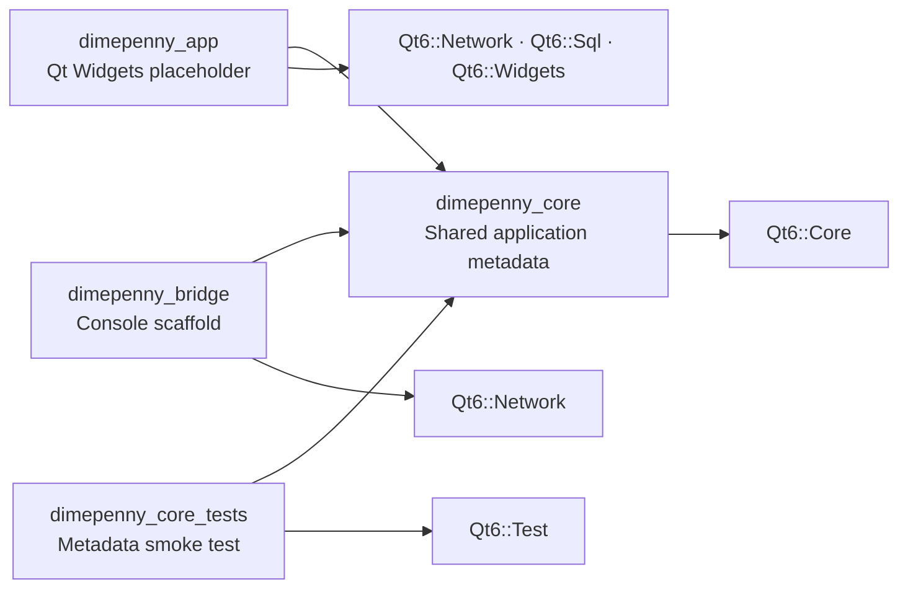
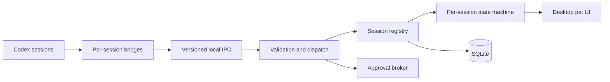

<div align="center">

# Dime&Penny

### A desktop presence for every Codex session

Dime&Penny is an early-stage Windows-first C++/Qt project exploring a desktop companion for concurrent Codex sessions. The repository currently proves the build boundaries—a placeholder GUI, bridge process, shared core library, and smoke test—while the session and pet experience remains planned work.

[](#development-status)
[](#technology)
[](#technology)
[](#build-the-scaffold)
[](#build-the-scaffold)

[Architecture](ARCHITECTURE.md) · [Implementation plan](PLAN.md) · [Prototype sketch](Prottotype_1.pdf) · [Build the scaffold](#build-the-scaffold)

</div>

## Why Dime&Penny?

Running several coding agents at once makes it difficult to answer simple questions: Which session is still working? Which one finished? Which agent needs approval? Which project does a notification belong to?

Dime&Penny is designed to make that activity visible without requiring constant window switching. The planned experience assigns one stable pet identity to each registered Codex session and changes its appearance only in response to validated lifecycle events.

The proposed first release is local and Windows-first: one persistent Qt desktop process, thin per-session bridges, versioned local IPC, and SQLite-backed state. The target design does not require a cloud service or public network listener.

## Scope and evidence

| Area | Evidence in this repository | Status |
|---|---|---|
| Build foundation | CMake configures C++20, generated version metadata, warnings, installation, and CTest | Implemented |
| Desktop executable | `dimepenny_app` opens a 480×220 Qt placeholder window | Scaffold |
| Bridge executable | `dimepenny_bridge` prints its name/version and exits | Scaffold |
| Core library | `dimepenny_core` exposes the generated application name and version | Implemented |
| Domain models | Session identity, project and pet metadata, lifecycle states and typed events; see [model contracts](docs/DOMAIN_MODELS.md) | Implemented |
| Automated checks | `dimepenny.core.smoke` verifies metadata; `dimepenny.domain.models` checks domain validation and identity | 2 CTest targets |
| Sessions and pets | Register up to 10 sessions and map each to a stable visual identity | Planned |
| Lifecycle and approvals | Validate session events and route decisions to the exact request | Planned |
| Persistence | Store session history and pet assignments in SQLite | Planned |
| Context linking | Build a reviewable brief from explicitly selected projects | Later phase |

The [prototype sketch](Prottotype_1.pdf) captures the early desktop concept and the idea of creating a new agent from user-reviewed context. It is a design reference, not a screenshot of the current application.

## Repository architecture

### Implemented dependency graph

This diagram reflects the committed CMake targets and link dependencies:



### Planned runtime architecture

The following flow is a design target. The IPC endpoint, dispatcher, registry, state machine, approval broker, pet UI, and SQLite repositories are not implemented in the current scaffold.



Domain state is intended to remain independent of widgets, sockets, and SQL. The full ownership rules, protocol envelope, event flow, failure behavior, and privacy boundaries are documented in [ARCHITECTURE.md](ARCHITECTURE.md).

## Technology

| Area | Technology | Purpose |
|---|---|---|
| Language | C++20 | Current application, bridge, and core targets |
| Desktop UI | Qt 6 Widgets | Current placeholder window; future pet windows |
| Local runtime | Qt Core and Qt Network | Event loop now; local IPC is planned |
| Persistence dependency | Qt SQL | Linked by the app, but not used by repository code yet |
| Build | CMake 3.24+ | Target configuration and generated build metadata |
| Tests | Qt Test and CTest | Current smoke test and future unit/integration tests |

## Project structure

```text
.
├── app/                    # Qt Widgets application scaffold
├── bridge/                 # Per-session bridge scaffold
├── cmake/                  # Generated build metadata template
├── include/dimepenny/      # Public core headers
├── src/                    # Reusable core library implementation
├── tests/                  # Qt Test targets
├── assets/                 # Reserved for packaged visual and audio assets
├── tools/                  # Reserved for development and packaging helpers
├── ARCHITECTURE.md         # Target system design and security boundaries
├── PLAN.md                 # Learn-and-build implementation roadmap
├── Prottotype_1.pdf        # Early product concept sketch
└── CMakeLists.txt          # Root build configuration
```

## Build the scaffold

### Prerequisites

- Windows
- CMake 3.24 or newer
- A C++20 compiler
- Ninja or another CMake-supported generator
- Qt 6 with the `Core`, `Network`, `Sql`, `Widgets`, and `Test` modules

Use a single, compatible compiler and Qt toolchain. For an MSYS2 UCRT64 setup, install the required packages from an **MSYS2 UCRT64 terminal**:

```sh
pacman -S --needed \
  mingw-w64-ucrt-x86_64-cmake \
  mingw-w64-ucrt-x86_64-ninja \
  mingw-w64-ucrt-x86_64-qt6-base
```

### Clone, configure, and build

Run the following commands from an MSYS2 UCRT64 terminal:

```sh
git clone https://github.com/falconmath27/CodexNotifier.git
cd CodexNotifier
cmake -S . -B build -G Ninja -DCMAKE_BUILD_TYPE=Debug -DBUILD_TESTING=ON
cmake --build build
```

To enforce warnings as errors during development, add `-DDIMEPENNY_WARNINGS_AS_ERRORS=ON` to the configure command.

### Run the tests

```sh
ctest --test-dir build --output-on-failure
```

The current suite contains one test, `dimepenny.core.smoke`, which checks that CMake generated the project name `DimePenny` and version `0.1.0` correctly.

### Run the executables

```sh
./build/app/DimePenny.exe
./build/bridge/DimePennyBridge.exe
```

`DimePenny.exe` opens the placeholder Qt window. `DimePennyBridge.exe` prints the scaffold version message and exits.

Run the executables from the same UCRT64 terminal used for the build so the matching Qt runtime directory remains on `PATH`.

## Development status

Version `0.1.0` is the initial project scaffold. The committed source does **not** yet connect to Codex, register sessions, render desktop pets, open an IPC server, store SQLite data, or handle approvals.

The next functional acceptance target in [PLAN.md](PLAN.md) is a simulated session registry that can register sessions safely, enforce the 10-session limit, reject duplicate identities, and assign stable pet identities. Later milestones add IPC, Qt pet windows, concurrency, persistence, verified Codex lifecycle events, and approval handling.

## Contributing

The architecture and build plan are still being established. Before proposing a change, read [ARCHITECTURE.md](ARCHITECTURE.md) and [PLAN.md](PLAN.md). Keep implementation claims, tests, and documentation aligned with what the repository actually supports.

The repository does not yet provide issue templates, a pull-request template, a code of conduct, or a dedicated contributing guide.

## License

This repository does not currently include a license file. Until a license is added, the source is publicly visible but no reuse, modification, or redistribution rights are granted by default.
