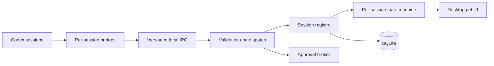

<div align="center">

# Dime&Penny

### A desktop presence for every Codex session

Dime&Penny is an early-stage Windows-first C++/Qt project exploring a desktop companion for concurrent Codex sessions. The repository currently proves the build boundaries—a placeholder GUI, bridge process, shared core library, and smoke test—while the session and pet experience remains planned work.

[](#development-status)
[](#technology)
[](#technology)
[](#build-the-scaffold)
[](#build-the-scaffold)

[Architecture](ARCHITECTURE.md) · [Implementation plan](PLAN.md) · [Prototype sketch](Prottotype_1.pdf) · [Build the scaffold](#build-the-scaffold)

</div>

## Why Dime&Penny?

Running several coding agents at once makes it difficult to answer simple questions: Which session is still working? Which one finished? Which agent needs approval? Which project does a notification belong to?

Dime&Penny is designed to make that activity visible without requiring constant window switching. The planned experience assigns one stable pet identity to each registered Codex session and changes its appearance only in response to validated lifecycle events.

The proposed first release is local and Windows-first: one persistent Qt desktop process, thin per-session bridges, versioned local IPC, and SQLite-backed state. The target design does not require a cloud service or public network listener.

## Scope and evidence

| Area | Evidence in this repository | Status |
|---|---|---|
| Build foundation | CMake configures C++20, generated version metadata, warnings, installation, and CTest | Implemented |
| Desktop executable | `dimepenny_app` opens a 480×220 Qt placeholder window | Scaffold |
| Bridge executable | Fake-session client with lifecycle and fault scenarios; see [simulator guide](docs/SIMULATED_BRIDGE.md) | Implemented |
| Core library | `dimepenny_core` exposes the generated application name and version | Implemented |
| Domain models | Session identity, project and pet metadata, lifecycle states and typed events; see [model contracts](docs/DOMAIN_MODELS.md) | Implemented |
| State machine | Validated transitions, event ordering, duplicate detection and approval correlation; see [transition rules](docs/STATE_MACHINE.md) | Implemented |
| Automated checks | Domain, registry, codec, server, bridge, event processing and four executable demo scenarios | 12 CTest targets |
| Event processing | Authenticated admission, validation, deduplication and isolated state-machine dispatch; see [processing contract](docs/EVENT_PROCESSING.md) | Implemented |
| Local IPC server | Authenticated session binding, concurrent local sockets and liveness deadlines; see [server contracts](docs/LOCAL_SERVER.md) | Implemented component |
| IPC protocol | Versioned JSON validation, bounded length-prefixed frames and incremental decoding; see [wire contract](docs/IPC_PROTOCOL.md) | Implemented |
| Session registry | Up to 10 enabled sessions, duplicate protection and stable pet assignments; see [registry contracts](docs/SESSION_REGISTRY.md) | Implemented |
| Desktop pets | QML windows with lifecycle-driven paw visuals; animal sprite artwork remains planned | Implemented |
| Approval integration | Deliver decisions and enforce expiry through the bridge | Planned |
| Persistence | Versioned SQLite sessions, identities, projects, events, registrations, settings and approval history | Implemented |
| Context linking | Build a reviewable brief from explicitly selected projects | Later phase |

The [prototype sketch](Prottotype_1.pdf) captures the early desktop concept and the idea of creating a new agent from user-reviewed context. It is a design reference, not a screenshot of the current application.

## Repository architecture

### Implemented dependency graph

This diagram reflects the committed CMake targets and link dependencies:


### Planned runtime architecture

The following flow is a design target. Domain models, state machine, registry, IPC server, simulator, event dispatcher, desktop UI and SQLite persistence are implemented. The approval broker remains planned.



Domain state is intended to remain independent of widgets, sockets, and SQL. The full ownership rules, protocol envelope, event flow, failure behavior, and privacy boundaries are documented in [ARCHITECTURE.md](ARCHITECTURE.md).

## Technology

| Area | Technology | Purpose |
|---|---|---|
| Language | C++20 | Current application, bridge, and core targets |
| Desktop UI | Qt Quick/QML + Fluent controls | Activation, session details, menus and desktop pet windows |
| Local runtime | Qt Core and Qt Network | Event loop now; local IPC is planned |
| Persistence dependency | Qt SQL | Linked by the app, but not used by repository code yet |
| Build | CMake 3.24+ | Target configuration and generated build metadata |
| Tests | Qt Test and CTest | Current smoke test and future unit/integration tests |

## Project structure

```text
.
├── app/                    # QML screens and C++ presentation adapters
├── bridge/                 # Per-session bridge scaffold
├── cmake/                  # Generated build metadata template
├── include/dimepenny/      # Public core headers
├── src/                    # Reusable core library implementation
├── tests/                  # Qt Test targets
├── assets/                 # Reserved for packaged visual and audio assets
├── tools/                  # Reserved for development and packaging helpers
├── ARCHITECTURE.md         # Target system design and security boundaries
├── PLAN.md                 # Learn-and-build implementation roadmap
├── Prottotype_1.pdf        # Early product concept sketch
└── CMakeLists.txt          # Root build configuration
```

## Build the scaffold

### Prerequisites

- Windows
- CMake 3.24 or newer
- A C++20 compiler
- Ninja or another CMake-supported generator
- Qt 6.8 or newer with `Core`, `Network`, `Sql`, `Quick`, `QuickControls2`, `Test`, and the QML Dialogs and FluentWinUI3 modules (verified with Qt 6.11.1)

Use a single, compatible compiler and Qt toolchain. For an MSYS2 UCRT64 setup, install the required packages from an **MSYS2 UCRT64 terminal**:

```sh
pacman -S --needed \
  mingw-w64-ucrt-x86_64-cmake \
  mingw-w64-ucrt-x86_64-ninja \
  mingw-w64-ucrt-x86_64-qt6-base \
  mingw-w64-ucrt-x86_64-qt6-declarative
```

### Clone, configure, and build

Run the following commands from an MSYS2 UCRT64 terminal:

```sh
git clone https://github.com/falconmath27/CodexNotifier.git
cd CodexNotifier
cmake -S . -B build -G Ninja -DCMAKE_BUILD_TYPE=Debug -DBUILD_TESTING=ON
cmake --build build
```

To enforce warnings as errors during development, add `-DDIMEPENNY_WARNINGS_AS_ERRORS=ON` to the configure command.

### Run the tests

```sh
ctest --test-dir build --output-on-failure
```

The suite contains 17 CTest targets covering metadata, domain models, state transitions, registry rules, IPC, simulated bridges, Codex exec and interactive PowerShell adapters, event processing, SQLite persistence, activation, and desktop pet windows. IPC tests require permission to open local named pipes. UI tests use Qt's offscreen platform. Persistence tests use temporary databases, never the user's app data. Adapter tests launch deterministic fixtures, not live model requests.

### Run the executables

```sh
./build/app/DimePenny.exe
./build/bridge/DimePennyBridge.exe --demo
```

`DimePenny.exe` opens the activation interface. Choose **Dime** or **Pennies**, browse to an existing project directory, select terminal metadata, then activate a simulated session. Only one orange **Dime** and nine **Pennies** can be activated. Pennies receive unused colors automatically and are named **Penny1** through **Penny9** in activation order. The UI shows availability and connection state. A disconnected session keeps its name, slot and color; select its row to reconnect. Registrations are saved and return as disconnected sessions after restarting the app.

Activation uses an in-process simulated bridge over authenticated local IPC; it does not launch a terminal or control Codex. Generated names are stored as the pet's display name in the existing registration protocol. Automatically assigned colors reserve identities, are included in the pet registration payload, and select the matching idle sprite animation. The activation controller enforces both companion limits, including while a connection is pending.

### Desktop pets (Task 10)

Each registered session gets one transparent, frameless, always-on-top tool window. It renders the assigned animated pixel pet with its generated name, companion type, and live state; states without dedicated sprite artwork retain the accessible paw fallback.

- Drag with the left mouse button. Positions stay inside a monitor's available work area, including monitors with negative coordinates. Display/work-area changes bring misplaced pets back on screen.
- With keyboard focus, use arrow keys to move 10 pixels or Shift + arrow for 1 pixel.
- Hover for session information. Double-click or press Enter for a non-modal details window that updates with the session.
- Right-click or press Shift+F10 for details, open project folder, reconnect a disconnected session, toggle always-on-top, reset position, show activation, or hide the pet.
- Hiding or closing a pet does not deactivate its session. Choose **Show pet** on its session in activation to restore it. Reconnect preserves the existing pet window and position.
- Pet positions are kept only while the app runs; position persistence remains future work. Closing the activation application ends its pet windows and simulated connections, but keeps their saved identities.

### Pet visual states (Task 11)

Validated lifecycle updates drive each session's own QML visual:

| State | Visual feedback |
| --- | --- |
| Connecting | Blue paw with cycling dots |
| Active / idle | Selected Orange, Yellow, Pink, Green, Blue, Purple, White, Blue-Green, Grey or Golden pet with a two- or four-frame blink loop |
| Working | Orange pixel pet working at a laptop |
| Completed | Teal paw with a check mark and a brief lift |
| Approval needed | Orange pixel pet with a compact looping flame |
| Error | Rose paw with a cross and a brief shake |

Unregistered, connecting, completed, error and disconnected states retain labelled paw visuals, so color is not the only cue. Right-click → **Animate pet** disables motion without hiding state feedback; the preference lasts for that pet window's lifetime. Hidden pets stop animating. Completion/error motion plays once rather than continuously demanding attention. Color identity, window position, and session state are not changed by these visual effects.

The UI tests drive the real state machine through all six states, approval resolution, disconnect/reconnect, motion toggling, hidden-window pausing, and cross-session isolation. Set `DIMEPENNY_CAPTURE_UI=1` when running the pet test to save a six-state preview as `pet-visual-states.png` in its working directory.

Automated tests cover flags, alpha transparency, drag/keyboard positioning, bounds, menu actions, details updates, session isolation, ownership, and activation/reconnect integration. A real multi-monitor Windows check is still recommended for compositor stacking, taskbar avoidance, monitor unplugging, and mixed-DPI behavior.

### Multiple pets (Task 12)

Up to ten sessions can remain connected simultaneously: one Dime and nine uniquely named Pennies with reserved idle-color appearances. Each session ID owns one pet window for the app's lifetime. Reconnect reuses that window, name, appearance, position, and hidden state; it does not allocate another slot. An eleventh activation is rejected.

Validated events mark only their own session's pet for an update. Presentation changes are coalesced on a 16 ms timer, so event bursts do not rebuild every pet or the activation list for every message. Every event still passes through validation and the state machine; only intermediate visual snapshots may be skipped. Hidden pets remain hidden, and shutdown cancels pending presentation updates.

The multi-pet integration test exercises ten authenticated bridges with 400 interleaved lifecycle events, independent final states, duplicate suppression, a UI event-loop timer, and reconnect identity. Idle sprites have distinct colors; shared working/approval artwork remains identifiable by each pet's unique name. The compact growing sidebar is a separate layout milestone; this task retains independent pet windows.

### SQLite persistence (Task 13)

The desktop executable stores `dimepenny.sqlite3` in Qt's `AppLocalDataLocation` (normally `%LOCALAPPDATA%/DimePenny/DimePenny` on Windows). The app creates that directory; startup errors are shown instead of silently replacing saved data. A lock prevents two app instances from writing the same database. The simulator CLI remains ephemeral unless its host explicitly enables persistence.

The versioned schema stores projects, stable pet identities, session snapshots, accepted lifecycle events, registration history, string-valued settings, and approval request/decision history. Schema migrations run transactionally using `PRAGMA user_version`; v2 adds and backfills approval history. Newer schemas are refused without downgrading them. Foreign keys, uniqueness constraints, WAL and full synchronous commits protect relationships and committed history.

Each accepted event, session snapshot and approval-history entry commits in one transaction before the UI is notified. Failed writes reject the update without consuming its event ID or sequence. Only accepted lifecycle events are retained, not rejected/malformed messages or heartbeat traffic. Authentication tokens are never saved. SQLite is not encrypted: the database contains local project paths and session metadata.

On restart, sessions restore as **Disconnected**, retaining slot reservations, identities, metadata, event deduplication IDs and ordering sequences. Reconnect provisions new credentials and the simulator continues its saved sequence. Historical approval records are retained, but pending approval actions are not resumed or executed. Window width/height are currently saved settings; pet positions, hidden state and animation preferences are not yet persisted across app restarts.

For backups, close the app first, then copy the database. Do not delete its WAL/SHM files while running. The tests cover schema upgrades, reopening, replay/order protection, transaction rollback, competing writers, restart/reconnect, and ten-session event bursts with persistence enabled. This milestone uses short synchronous transactions on the event-loop thread with a bounded 100 ms lock wait; a background writer and history retention policy remain future optimizations.

### Restart recovery (Task 14)

Startup validates saved identities and capacity before exposing any restored session. It then atomically changes every saved session snapshot to `Disconnected` in SQLite, including snapshots left `Active`, `Working` or `ApprovalNeeded` by an abrupt exit. Event, registration and approval history, settings, sequence numbers and pet assignments are preserved. If recovery validation or the database reset fails, no partially restored registry is published and the desktop does not start its server. Recovery cannot be enabled after the server starts listening.

The desktop restores reserved pets without connecting their bridges automatically. Choose **Reconnect** for each session you want to resume. A new process has no old authentication secrets: a fresh authorized registration with matching session/pet/project metadata is required. Registration moves the session only to `Connecting`; a newly accepted `SessionConnected` event is required for `Active`. Old credentials, unregistered socket events, duplicate event IDs and stale sequences cannot reactivate a pet. Pending approvals from the previous run remain history, not executable actions.

Recovery tests seed committed snapshots in all eight lifecycle states (simulating an abrupt exit without a graceful-disconnect write), check database and in-memory states, inject a recovery-write failure, and verify all ten UI assignments across restart. These tests use temporary databases and local authenticated sockets, not real Codex sessions.

### Real Codex adapter (Task 15)

An opt-in adapter launches a new `codex exec --json` run and maps explicit thread/turn lifecycle events to its pet. Normal activation and the bridge demo remain simulated. No terminal text is used to guess activity. Read [the verified contract and launch instructions](docs/CODEX_INTEGRATION.md) for supported states, safety boundaries and restart behavior. This first adapter does not attach to existing Codex windows, resume old real threads, or handle interactive approvals.

### Interactive PowerShell integration (Task 15B)

Launch interactive Codex from a project folder with `tools/Start-DimePennyCodex.ps1`.
It assigns one pet per terminal, uses trusted structured Codex hooks (no terminal
text parsing), and isolates heartbeats, lifecycle events and disconnects. The
existing simulation and noninteractive exec modes remain available.

**One-time hook installation and `/hooks` review are required.** See
[setup, launch and reconnect instructions](docs/INTERACTIVE_POWERSHELL.md).
Ordinary `codex` launched without the wrapper is not automatically tracked.

### Qt Quick presentation

The app uses QGuiApplication and QQuickView; it no longer links Qt Widgets. The screens in `app/qml/Activation.qml` and `app/qml/Pet.qml` are embedded in the executable through `app/ui.qrc`. Qt Quick Controls use FluentWinUI3 with an explicit light theme. The C++ presentation adapters expose properties and commands to QML; EventProcessor and the domain remain responsible for authenticated state changes.

Pet windows are independent top-level tool windows owned by the activation controller, so minimizing activation does not minimize the pets. Closing activation stops the local server and hides all pets. The details window and folder picker are QML too. Additional state-specific color sprite sets and position persistence remain separate milestones.

For deployment, include the QML runtime and imports as well as Qt libraries. Run the matching Qt toolchain's `windeployqt` with `--qmldir app/qml` against the executable in a staging folder; a CMake install alone is not a standalone installer.

`DimePennyBridge.exe --demo` starts an isolated server, authenticates a fake session, sends lifecycle events and exits.

Run the executables from the same UCRT64 terminal used for the build so the matching Qt runtime directory remains on `PATH`.

## Development status

Version `0.1.0` includes domain and IPC components, a fake-session demo, the activation interface, lifecycle-animated desktop pets, SQLite persistence, an opt-in Codex exec adapter, and a trusted-hook interactive PowerShell launcher. Automatic attachment to already-running Codex terminals, additional sprite artwork and approval execution remain planned.

The implemented registry enforces the 10-session limit, rejects duplicate identities, and assigns stable pet identities. Later milestones in [PLAN.md](PLAN.md) extend animation, verified Codex lifecycle events, and approval handling.

## Contributing

The architecture and build plan are still being established. Before proposing a change, read [ARCHITECTURE.md](ARCHITECTURE.md) and [PLAN.md](PLAN.md). Keep implementation claims, tests, and documentation aligned with what the repository actually supports.

The repository does not yet provide issue templates, a pull-request template, a code of conduct, or a dedicated contributing guide.

## License

This repository does not currently include a license file. Until a license is added, the source is publicly visible but no reuse, modification, or redistribution rights are granted by default.
